

  <picture>
    <source media="(prefers-color-scheme: dark) and (max-width: 600px)" srcset="./assets/header-mobile.svg" />
    <source media="(max-width: 600px)" srcset="./assets/header-mobile-light.svg" />
    <source media="(prefers-color-scheme: dark)" srcset="./assets/header.svg" />
    
  </picture>

  &nbsp;
  &nbsp;
  

I'm studying Cyber Operations at Dakota State University, with a minor in Network Security Administration. I work as an IT Support Desk Technician on campus. At home, I build apps on my own servers and run a Wazuh SOC to monitor them.

## Main stack

### Security & infrastructure

  
  
  
  
  
  

### Development & data

  
  
  
  
  
  

More technologies &amp; tools (38)

#### Security & networking

  
  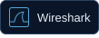
  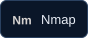
  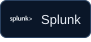
  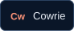
  
  
  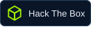

#### Languages

  
  
  
  
  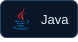

#### Web & frameworks

  
  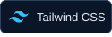
  
  

#### Cloud & DevOps

  
  
  

#### Databases & services

  
  
  

#### AI & automation

  
  
  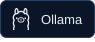
  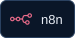
  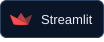
  
  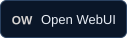
  

#### Tools & platforms

  
  
  
  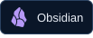
  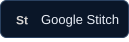
  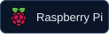
  

## Selected projects

<table>
  <tr>
    <td width="288" valign="top">
      

        <a href="https://github.com/pokharelsandeep333-commits/wazuh-home-soc">
          <picture>
            <source media="(prefers-color-scheme: dark)" srcset="./assets/projects/wazuh-tile.svg" />
            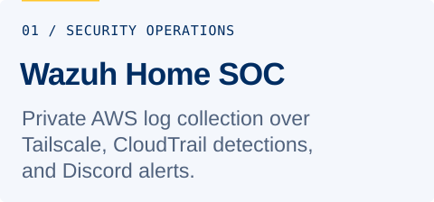
          </picture>
        </a>
      

      
<code>Wazuh&nbsp;·&nbsp;Tailscale&nbsp;·&nbsp;AWS&nbsp;EC2&nbsp;·&nbsp;Docker</code>

      

        &nbsp;
      

    </td>
    <td width="288" valign="top">
      

        <a href="https://github.com/pokharelsandeep333-commits/ShiftSentry">
          <picture>
            <source media="(prefers-color-scheme: dark)" srcset="./assets/projects/shiftsentry-tile.svg" />
            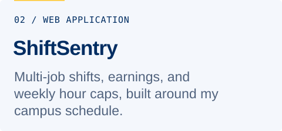
          </picture>
        </a>
      

      
<code>Next.js&nbsp;·&nbsp;TypeScript&nbsp;·&nbsp;PostgreSQL</code>

      

        &nbsp;
      

    </td>
    <td width="288" valign="top">
      

        <a href="https://github.com/pokharelsandeep333-commits/Portfolio">
          <picture>
            <source media="(prefers-color-scheme: dark)" srcset="./assets/projects/portfolio-tile.svg" />
            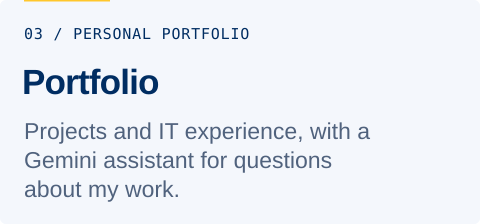
          </picture>
        </a>
      

      
<code>React&nbsp;·&nbsp;Vite&nbsp;·&nbsp;GSAP&nbsp;·&nbsp;Gemini&nbsp;API</code>

      

        &nbsp;
      

    </td>
  </tr>
</table>

## Contribution skyline

  <a href="https://github.com/pokharelsandeep333-commits?tab=overview">
    <picture>
      <source media="(prefers-color-scheme: dark) and (max-width: 600px)" srcset="./assets/activity/skyline-mobile.svg" />
      <source media="(max-width: 600px)" srcset="./assets/activity/skyline-mobile-light.svg" />
      <source media="(prefers-color-scheme: dark)" srcset="./assets/activity/skyline.svg" />
      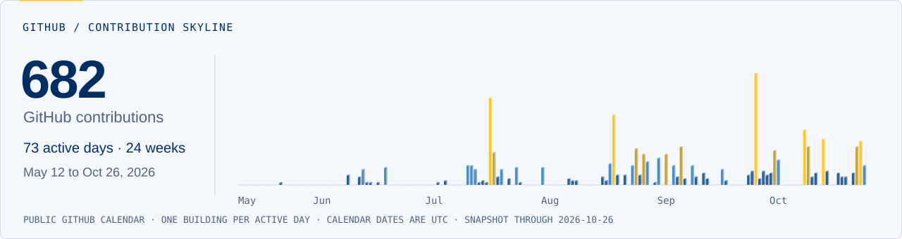
    </picture>
  </a>

A 24-week snapshot of my <a href="https://github.com/pokharelsandeep333-commits?tab=overview">public GitHub calendar</a>, through October 30, 2026. Updated daily.
